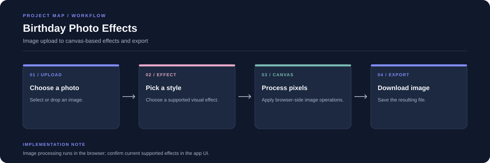

# Birthday Photo Effects

A React and Vite web app for adding visual effects to birthday photos. The interface uses browser canvas processing and a dark navy theme with restrained indigo accents.

**Stack:** React, Vite, JavaScript, HTML Canvas, CSS



## Workflow

1. Upload or select an image.
2. Choose one of the effects supported by the interface.
3. Process the image with the browser canvas.
4. Preview and download the result.

## Run locally

```bash
git clone https://github.com/chyk2468/Birthday-Special-Website.git
cd Birthday-Special-Website
npm install
npm run dev
```

Use the local Vite URL shown in the terminal.

## Files

- `App.jsx`: application interface and interactions
- `main.js`: app entry point
- `style.css`: visual theme and responsive layout
- `package.json`: scripts and dependencies

## Notes

Large images may take longer to process on slower devices. Make sure you have permission to edit and share the photos you upload.
