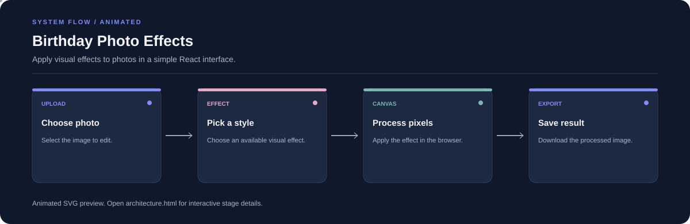

# Birthday Photo Effects

**Apply visual effects to photos in a simple React interface.**

[](https://github.com/chyk2468/Birthday-Special-Website)

## 1. Project Title & Tagline

Apply visual effects to photos in a simple React interface.

## 2. Problem Statement

Adding a playful effect to a birthday photo can require a separate editor. This project provides a browser interface for applying supported effects and exporting the result.

## 3. Project Preview

Add a real screenshot or short GIF of the current interface and a before/after result.

[Open interactive architecture](architecture.html)

## 4. Overview

The project accepts source content, runs the configured workflow, and presents a result for review. The diagram below summarises the main stages.

## 5. Key Features

- Upload or select an image.
- Choose a supported visual effect.
- Process the image with browser canvas operations.
- Preview and download the result.

## 6. Architecture / Workflow



Open the [interactive architecture explorer](architecture.html) to select a stage and inspect its role.

## 7. Tech Stack

React, Vite, JavaScript, HTML Canvas, CSS

## 8. Installation & Setup

```bash
git clone https://github.com/chyk2468/Birthday-Special-Website.git
cd Birthday-Special-Website
npm install
npm run dev
```

## 9. Usage

Open the local Vite URL, choose a photo, apply one of the available effects, preview the result, and download the edited image.

## 10. Project Structure

- `App.jsx`: application interface and interactions
- `main.js`: app entry point
- `style.css`: styling and layout
- `package.json`: scripts and dependencies

## 11. Results & Demo

Add a before/after screenshot or GIF showing one supported effect and the export flow.

## 12. Future Enhancements

- Add more configurable effects.
- Improve mobile upload and preview interactions.
- Show image dimensions and export options.
- Add tests for image formats and large inputs.

## 13. License

Check the licences for the source code and any included visual assets.
